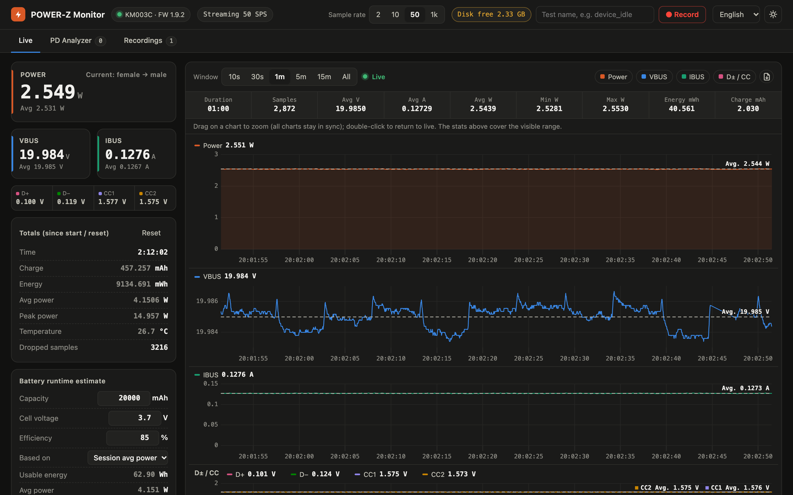
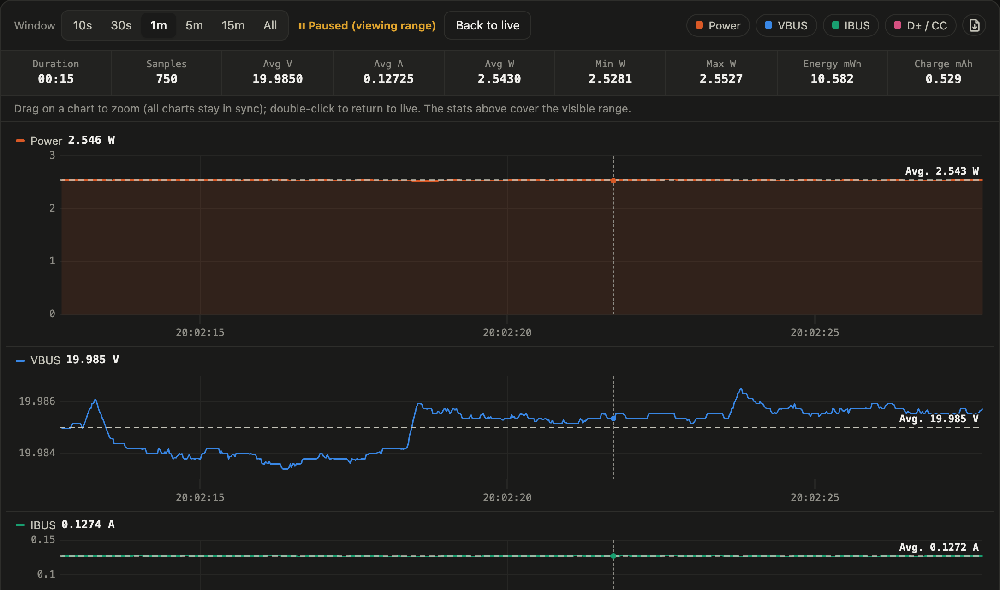
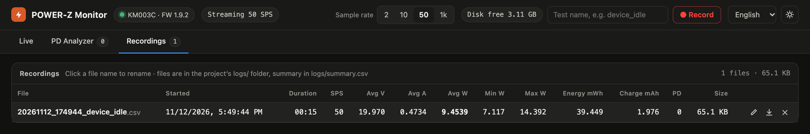
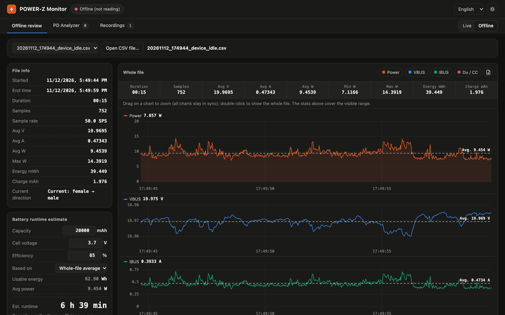
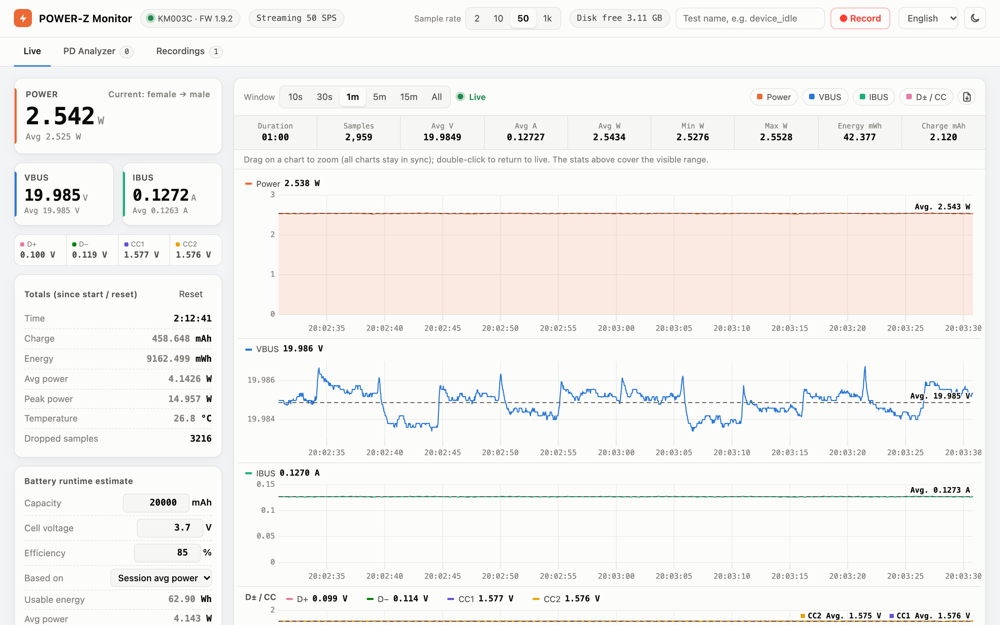

# POWER-Z KM003C Monitor

[繁體中文](README.md) | [简体中文](README.zh-Hans.md) | **English** | [日本語](README.ja.md) | [한국어](README.ko.md)

A web dashboard for the [ChargerLAB POWER-Z KM003C](https://www.chargerlab.com/) USB-C power meter on macOS. It talks to the meter directly over USB, so the official Windows software isn't needed. You get live voltage, current and power charts, CSV recording, and USB PD packet capture with decoding.



## Features

- **Live meters**: VBUS / IBUS / power, D+ / D− / CC1 / CC2, temperature, current direction; running time, mAh, mWh, average and peak power
- **High-rate charts**: 2 / 10 / 50 / 1000 SPS (using the meter's AdcQueue streaming)
  - Four charts (Power, VBUS, IBUS, D± / CC) with a synced cursor, scrolling smoothly at up to 60 fps
  - Time window from 10 s to all; drag to zoom (all four charts follow), double-click to return to live
  - A dashed line marks each chart's average over the visible range; the stats row shows duration, samples, avg V / A / W, min / max W, energy and charge
  - Export the raw data of the visible range as CSV
- **PD analyzer**: captures and decodes USB PD messages
  - PDOs in Source_Capabilities (Fixed / PPS / AVS, etc.)
  - RDOs in Request, matched to the requested voltage level
  - VDMs and other messages
  - Hide GoodCRC, export as CSV
- **Recording**: each recording is saved as a CSV in `logs/`, with a summary row added to `logs/summary.csv`; PD messages captured during a recording go to `*_pd.csv`
  - Rename, save as, or delete recordings from the Recordings tab
- **Offline review**: switch to Offline to stop reading the POWER-Z and open a saved CSV instead (pick a recording, or open any CSV on your computer), then review the whole run with the same charts, drag-to-zoom and range statistics
- **Disk guard**: free space is shown in the top-right corner. Below the limit (1 GB by default) a new recording won't start, and a running one is stopped and saved
- **Battery runtime estimate**: enter capacity, cell voltage and efficiency to estimate how long a battery would last at the average power
- **UI**: dark / light mode; languages: Traditional Chinese (default), Simplified Chinese, English, Japanese, Korean

## Screen tour

### Live

The screenshot at the top shows the Live tab:

- **Meters on the left**: POWER and VBUS / IBUS with the meter's own averages, plus the current direction in the top-right of the POWER card; below them, D+ / D− / CC1 / CC2 voltages.
- **Totals**: time, charge (mAh), energy (mWh), average and peak power, temperature, and dropped samples (normally 0) since start or since you pressed "Reset". "Reset" starts over: it clears the totals, every curve on the charts, and the PD log (press and slide the knob to the right end, so it can't fire by accident). A recording in progress and saved recordings are not affected.
- **Battery runtime estimate**: enter battery capacity, cell voltage and efficiency to estimate runtime at the average power (see [below](#battery-runtime-estimate)).
- **Top-right corner**: sample rate (2 / 10 / 50 / 1k SPS), recording, language, and dark / light mode.
- **Charts**: pick a time window (10 s to all). The colored buttons show or hide individual charts, and the icon at the far right exports the raw data of the visible range as CSV. The dashed line and "Avg." label on each chart are the average over the visible range.

### Zooming and range statistics



**Drag** on any chart and all four charts zoom to the same time range and pause ("Paused"). The stats row then shows that range's duration, sample count, avg V / A / W, min / max power, energy and charge, which makes it easy to measure consumption during a specific action such as booting or playing a video. Press "Back to live" or **double-click** a chart to resume live scrolling.

### Recording


Enter a test name in the top-right corner and press "● Record". While recording, the elapsed time and current file size are shown; press "■ Stop" to finish and save.



The Recordings tab lists a summary of every recording. **Click a file name** to rename it. The three icons on the right are rename, save as (Chrome / Edge open a save dialog so you can pick a location), and delete.

### Offline review



Click **Offline** at the right end of the tab bar. The app stops reading the POWER-Z (and releases USB, so other tools can use it) and the screen switches to reviewing a saved CSV:

- Pick a recording from the drop-down, or press "Open CSV file…" to choose a file on your computer. Each row in the Recordings tab also has a chart icon that opens it in offline mode.
- The charts start with the whole file. Drag to zoom, double-click to show the whole file again; the stats row and average lines work as in live mode.
- The POWER, VBUS and IBUS cards on the left show averages (the whole file, or the visible range once zoomed). Below them, "Totals (whole file)" lists start / end time, time, charge, energy, average and peak power, and current direction. The battery estimate uses the whole-file average power.
- Both recording files and files from the chart's CSV export can be opened. Files are parsed in the browser as they stream in; an hour at 1000 SPS (about 320 MB, 3.6 million rows) opens in about 2 seconds.
- You can't switch to offline while recording. Click **Live** to reconnect and resume live monitoring.

### Dark / light mode and languages



Switch the language (Traditional Chinese, Simplified Chinese, English, Japanese, Korean) and dark / light mode in the top-right corner. Your choices are remembered by the browser.

### PD Analyzer

The PD Analyzer tab lists captured USB PD messages. Click one to see it decoded on the right: each voltage / current level in Source_Capabilities, which level a Request asks for, flags, and the raw bytes. Re-plug the device under test to see the full negotiation.

## Requirements

- macOS (tested on Apple Silicon, macOS 27)
- Python 3.10 or newer
- `libusb` from [Homebrew](https://brew.sh/)
- A POWER-Z KM003C with its data port connected to the computer by USB (tested on firmware 1.9.2)

## Installation

```bash
git clone https://github.com/alanyeh1128/powerz-km003c-monitor.git
cd powerz-km003c-monitor
brew install libusb
python3 -m venv .venv
.venv/bin/pip install -r requirements.txt
```

## Usage

Double-click `PowerZ Monitor.command` in Finder, or run:

```bash
.venv/bin/python powerz_monitor.py
```

The dashboard opens in your browser at <http://127.0.0.1:8780/>. Press `Ctrl+C` to quit.

| Option | Default | Description |
|---|---|---|
| `--rate 0..3` | `2` | Sample rate at startup: 0 = 2 SPS, 1 = 10 SPS, 2 = 50 SPS, 3 = 1000 SPS (can be changed in the UI) |
| `--port` | `8780` | Web server port (listens on 127.0.0.1 only) |
| `--min-free-gb` | `1` | Stop recording when free disk space drops below this |
| `--no-browser` | | Don't open the browser at startup |

### Measurement tips

- **50 SPS** is enough for long power-consumption runs; switch to 1000 SPS only to catch short current spikes
- To capture a PD negotiation, open the PD Analyzer tab first, then re-plug the device under test

## Recording file format

**`logs/<time>_<name>.csv`**: one row per sample

| Column | Description |
|---|---|
| `timestamp` | Local time, millisecond resolution |
| `elapsed_s` | Seconds since the recording started |
| `vbus_V`, `ibus_A`, `power_W` | Voltage, current (raw sign from the meter), power (absolute value) |
| `dp_V`, `dm_V`, `cc1_V`, `cc2_V` | D+ / D− / CC1 / CC2 voltages |

**`logs/summary.csv`**: one row per recording with duration, sample rate, avg V / A / W, min / max W, energy (mWh), charge (mAh) and PD message count.

**`logs/<time>_<name>_pd.csv`**: PD messages captured during the recording, with time, SOP, role, message type, decoded content and raw bytes.

Each row is about 90 bytes: roughly 16 MB/hour at 50 SPS and 320 MB/hour at 1000 SPS.

### Current direction (sign of `ibus_A`)

Measured on a KM003C (firmware 1.9.2): with the power source on the **female** port and the device under test on the **male** plug (the normal setup), IBUS is **negative**; the reverse setup reads positive. This is the opposite of what the protocol notes referenced below describe. The UI shows the direction in words ("Current: female → male" or "Current: male → female"), so you don't need to interpret the sign yourself.

## Battery runtime estimate

```
Runtime = capacity (mAh) × cell voltage (V) × efficiency ÷ average power (W)
```

A power bank's mAh rating refers to its cell voltage (usually 3.6–3.85 V), while the device under test may be powered at 20 V. Dividing mAh by the current on VBUS would overestimate runtime several times over, so the estimate converts through energy instead. Efficiency covers the boost-conversion loss; typical PD power banks are around 80–90%.

## Notes

- Only one program can talk to the POWER-Z at a time. Close other tools that read from it first.
- While streaming (at any sample rate) the meter doesn't update its temperature; the UI shows the last reading taken before streaming started.
- Only tested on macOS. Linux should work in principle but may need udev permissions, or unbinding the kernel's `powerz` hwmon driver first.

## Project layout

```
powerz_monitor.py        Web server, sampling loop, statistics, recording, disk guard
km003c.py                KM003C USB driver (connect, auth, ADC, AdcQueue streaming, PD packets)
pd_decode.py             USB PD message decoder (PDO / RDO / VDM)
static/index.html        Web UI
static/i18n.js           UI strings for each language
static/uPlot.*           Chart library (uPlot 1.6.30, MIT)
PowerZ Monitor.command   macOS double-click launcher
```

## Acknowledgements

- KM003C USB protocol details (packet format, authentication, AdcQueue, PD packets) are based on [okhsunrog/km003c-protocol-research](https://github.com/okhsunrog/km003c-protocol-research)
- Charts are drawn with [uPlot](https://github.com/leeoniya/uPlot) (MIT License, see `static/uPlot.LICENSE`)

## Disclaimer

This is an unofficial project, not affiliated with ChargerLAB. POWER-Z is a trademark of ChargerLAB. The protocol implementation is based on third-party reverse-engineering notes and isn't guaranteed to work with every firmware version.

## License

[MIT License](LICENSE)
