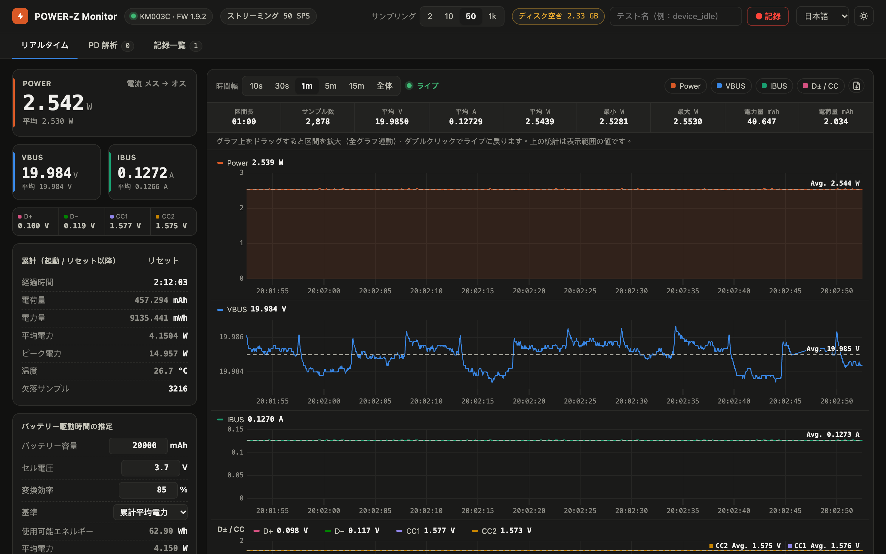
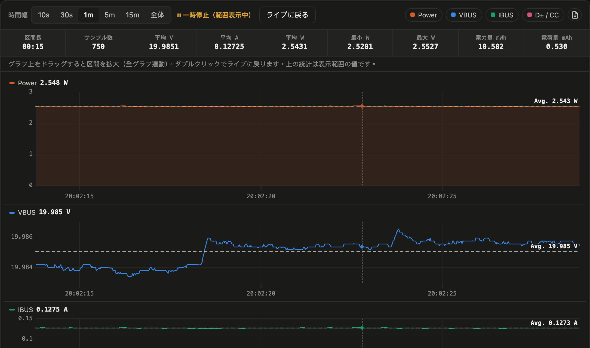
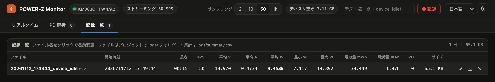
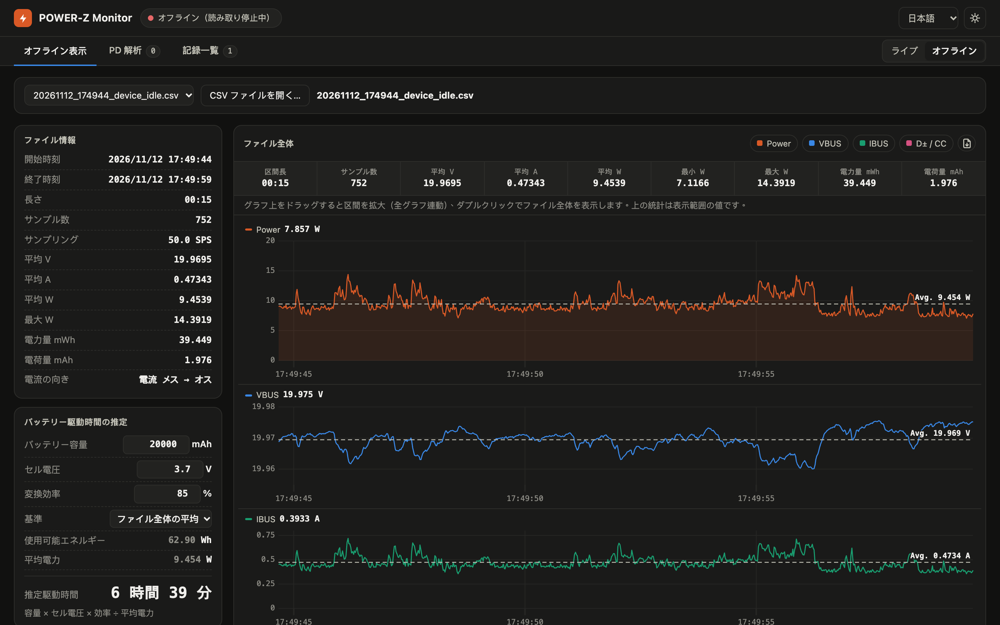
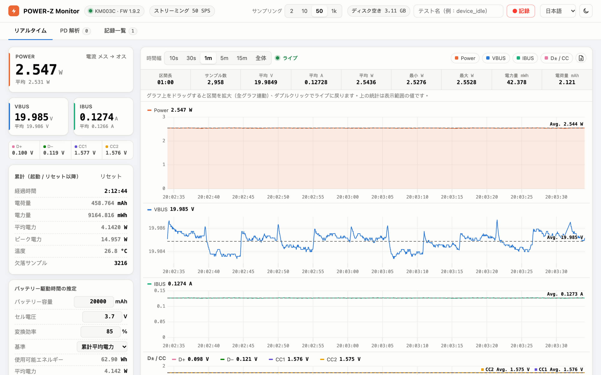

# POWER-Z KM003C Monitor

[繁體中文](README.md) | [简体中文](README.zh-Hans.md) | [English](README.en.md) | **日本語** | [한국어](README.ko.md)

macOS で [ChargerLAB POWER-Z KM003C](https://www.chargerlab.com/) USB-C 電力計のデータを表示する Web ダッシュボードです。USB で計測器と直接通信するため、公式の Windows ソフトは不要です。電圧・電流・電力のリアルタイムグラフ、CSV 記録、USB PD パケットの取得とデコードに対応しています。



## 機能

- **リアルタイム表示**：VBUS / IBUS / Power、D+ / D− / CC1 / CC2、温度、電流の向き。経過時間、mAh、mWh、平均・ピーク電力の累計
- **高速グラフ**：サンプリングレート 2 / 10 / 50 / 1000 SPS（計測器の AdcQueue ストリーミングを使用）
  - Power、VBUS、IBUS、D± / CC の 4 つのグラフ。カーソルは連動し、最大 60 fps でなめらかにスクロール
  - 時間幅は 10 秒から全体まで。ドラッグで区間を拡大（4 つのグラフが連動）、ダブルクリックでライブに戻る
  - 各グラフに表示範囲の平均値を破線で表示。統計行には区間長、サンプル数、平均 V / A / W、最小 / 最大 W、電力量、電荷量を表示
  - 表示範囲の生データを CSV で書き出し可能
- **PD 解析**：USB PD メッセージを取得してデコード
  - Source_Capabilities の PDO（Fixed / PPS / AVS など）
  - Request の RDO（どの電圧段を要求しているかを自動で対応付け）
  - VDM などその他のメッセージ
  - GoodCRC の非表示、CSV 書き出しに対応
- **記録**：記録ごとに CSV を `logs/` に保存し、統計の要約を `logs/summary.csv` に追記。記録中に PD メッセージがあれば `*_pd.csv` にも保存
  - 記録一覧で名前の変更、名前を付けて保存、削除が可能
- **オフライン表示**：「オフライン」に切り替えると POWER-Z の読み取りを止め、保存済みの CSV（記録一覧から選ぶか、PC 内の任意の CSV）を開いて、同じグラフ・ドラッグ拡大・区間統計で計測全体を見直せます
- **ディスク保護**：右上に空き容量を表示。しきい値（既定 1 GB）を下回ると記録を開始できず、記録中なら自動で停止して保存
- **バッテリー駆動時間の推定**：バッテリー容量、セル電圧、変換効率を入力すると、平均電力からおおよその駆動時間を推定
- **UI**：ダーク / ライトモード。言語は繁体字中国語（既定）、簡体字中国語、English、日本語、한국어

## 画面ガイド

### リアルタイム

一番上のスクリーンショットがリアルタイム画面です。

- **左側のメーター**：上段は POWER と VBUS / IBUS の現在値と計測器側の平均値で、POWER カードの右上に電流の向きを表示します。その下の 1 行は D+ / D− / CC1 / CC2 の電圧です。
- **累計**：起動時、または「リセット」を押してからの経過時間、電荷量 (mAh)、電力量 (mWh)、平均・ピーク電力、温度、欠落サンプル数（通常は 0）。「リセット」を押すと最初からやり直します。累計、グラフのすべての曲線、PD パケットが消去されます（誤操作を防ぐため、ボタンを押したまま右端までスライドしたときだけ実行されます）。記録中のファイルと保存済みの記録には影響しません。
- **バッテリー駆動時間の推定**：バッテリー容量、セル電圧、変換効率を入力すると、平均電力から駆動時間を推定します（計算方法は[下記](#バッテリー駆動時間の推定)）。
- **右上**：サンプリングレート（2 / 10 / 50 / 1k SPS）、記録、言語、ダーク / ライトモードの切り替え。
- **グラフ**：時間幅（10 秒〜全体）を選べます。右側の色付きボタンで各グラフの表示 / 非表示を切り替え、右端のアイコンで表示範囲の生データを CSV に書き出します。各グラフの破線と「Avg.」ラベルは表示範囲の平均値です。

### 区間の拡大と区間統計



いずれかのグラフ上で**ドラッグ**すると、4 つのグラフが同じ時間範囲に拡大され、「一時停止」状態になります。統計行にはその区間の長さ、サンプル数、平均 V / A / W、最小 / 最大電力、電力量、電荷量が表示されるので、起動や動画再生など特定の操作中の消費電力を測るのに便利です。「ライブに戻る」を押すか、グラフを**ダブルクリック**するとリアルタイム表示に戻ります。

### 記録


右上にテスト名を入力して「● 記録」を押します。記録中は経過時間と現在のファイルサイズが表示されます。もう一度「■ 停止」を押すと終了して保存されます。



「記録一覧」タブには各記録の統計の要約が並びます。**ファイル名をクリック**するとその場で名前を変更できます。右側の 3 つのアイコンは、名前の変更、名前を付けて保存（Chrome / Edge では保存先を選ぶダイアログが開きます）、削除です。

### オフライン表示



タブバー右端の「オフライン」を押すと、POWER-Z の読み取りを止め（USB も解放するので、ほかのツールで使えます）、保存済み CSV の表示に切り替わります。

- ドロップダウンから記録を選ぶか、「CSV ファイルを開く…」で PC 内のファイルを選びます。記録一覧の各行にあるグラフアイコンからも、オフラインで直接開けます。
- グラフは最初にファイル全体を表示します。ドラッグで区間を拡大、ダブルクリックでファイル全体に戻ります。統計行と平均線はライブ表示と同じです。
- 左側の POWER・VBUS・IBUS は平均値を表示します（拡大前はファイル全体、拡大後は表示範囲）。その下の「累計（ファイル全体）」には開始 / 終了時刻、経過時間、電荷量、電力量、平均・ピーク電力、電流の向きが並びます。バッテリー駆動時間の推定にはファイル全体の平均電力を使います。
- 記録ファイルのほか、グラフの CSV 書き出しで作ったファイルも開けます。ファイルはブラウザーで読み込みながら解析するので、1000 SPS で 1 時間分（約 320 MB、360 万行）でも約 2 秒で開けます。
- 記録中はオフラインに切り替えられません。「ライブ」を押すと再接続してライブ表示に戻ります。

### ダーク / ライトモードと多言語対応



右上で言語（繁体字中国語、簡体字中国語、English、日本語、한국어）とダーク / ライトモードを切り替えられます。選択はブラウザーに保存され、次回も引き継がれます。

### PD 解析

「PD 解析」タブには取得した USB PD メッセージが一覧表示されます。いずれかを選ぶと右側にデコード内容が表示されます：Source_Capabilities の各電圧・電流段、Request がどの段を要求しているか、フラグ、生データ。被測定機器を抜き差しすると、ネゴシエーションの流れ全体を確認できます。

## 動作環境

- macOS（Apple Silicon、macOS 27 で動作確認）
- Python 3.10 以上
- [Homebrew](https://brew.sh/) でインストールした `libusb`
- POWER-Z KM003C（データポートを USB ケーブルで PC に接続。ファームウェア 1.9.2 で動作確認）

## インストール

```bash
git clone https://github.com/alanyeh1128/powerz-km003c-monitor.git
cd powerz-km003c-monitor
brew install libusb
python3 -m venv .venv
.venv/bin/pip install -r requirements.txt
```

## 使い方

Finder で `PowerZ Monitor.command` をダブルクリックするか、ターミナルで次を実行します：

```bash
.venv/bin/python powerz_monitor.py
```

ブラウザーで <http://127.0.0.1:8780/> が自動的に開きます。終了するには `Ctrl+C` を押します。

| オプション | 既定値 | 説明 |
|---|---|---|
| `--rate 0..3` | `2` | 起動時のサンプリングレート：0 = 2 SPS、1 = 10 SPS、2 = 50 SPS、3 = 1000 SPS（あとから画面で変更可能） |
| `--port` | `8780` | Web サーバーのポート（127.0.0.1 のみで待ち受け） |
| `--min-free-gb` | `1` | ディスクの空き容量がこの値を下回ると記録を停止 |
| `--no-browser` | | 起動時にブラウザーを開かない |

### 計測のヒント

- 長時間の消費電力計測は **50 SPS** で十分です。瞬間的な電流のピークを見たいときだけ 1000 SPS に切り替えてください
- PD のネゴシエーションを取得するときは、先に「PD 解析」タブを開いてから被測定機器を抜き差ししてください

## 記録ファイルの形式

**`logs/<時刻>_<名前>.csv`**：1 サンプル 1 行

| 列 | 説明 |
|---|---|
| `timestamp` | ローカル時刻（ミリ秒まで） |
| `elapsed_s` | 記録開始からの経過秒数 |
| `vbus_V`, `ibus_A`, `power_W` | 電圧、電流（計測器が出力した符号のまま）、電力（絶対値） |
| `dp_V`, `dm_V`, `cc1_V`, `cc2_V` | D+ / D− / CC1 / CC2 電圧 |

**`logs/summary.csv`**：記録ごとに 1 行。長さ、サンプリングレート、平均 V / A / W、最小 / 最大 W、電力量 mWh、電荷量 mAh、PD メッセージ数を含みます。

**`logs/<時刻>_<名前>_pd.csv`**：記録中に取得した PD メッセージ。時刻、SOP、ロール、メッセージ種別、デコード内容、生データを含みます。

CSV は 1 行あたり約 90 バイトです。50 SPS で約 16 MB/時、1000 SPS で約 320 MB/時になります。

### 電流の向き（`ibus_A` の符号）

KM003C（ファームウェア 1.9.2）での実測では、電源を**メス**側、被測定機器を**オス**側につなぐ通常の接続で IBUS は**負の値**になり、逆向きにつなぐと正の値になります。これは下記の参考プロトコル資料の記述とは逆です。画面には「電流 メス → オス」または「電流 オス → メス」と向きが文字で表示されるので、符号を自分で判断する必要はありません。

## バッテリー駆動時間の推定

```
駆動時間 = 容量 (mAh) × セル電圧 (V) × 変換効率 ÷ 平均電力 (W)
```

モバイルバッテリーの mAh 表記はセル電圧（通常 3.6〜3.85 V）を基準にしていますが、被測定機器は 20 V で給電されている場合があります。mAh を VBUS 側の電流で割ると何倍も過大に見積もってしまうため、ここではエネルギーに換算して計算します。変換効率は昇圧時の損失を含み、一般的な PD 対応モバイルバッテリーでは 80〜90% 程度です。

## 注意事項

- POWER-Z に同時に接続できるプログラムは 1 つだけです。先にほかの読み取りツールを終了してください。
- ストリーミング中（どのサンプリングレートでも）計測器は温度を更新しません。画面にはストリーミング開始前の最後の値が表示されます。
- 動作確認は macOS のみです。Linux でも理論上は動作しますが、udev の権限設定や、カーネル組み込みの `powerz` hwmon ドライバーのアンバインドが必要になる場合があります。

## プロジェクト構成

```
powerz_monitor.py        Web サーバー、サンプリングループ、統計、記録、ディスク保護
km003c.py                KM003C USB ドライバー（接続、認証、ADC、AdcQueue ストリーミング、PD パケット）
pd_decode.py             USB PD メッセージのデコーダー（PDO / RDO / VDM）
static/index.html        Web UI
static/i18n.js           UI の多言語文字列
static/uPlot.*           グラフライブラリー（uPlot 1.6.30、MIT）
PowerZ Monitor.command   macOS 用のダブルクリック起動スクリプト
```

## 謝辞

- KM003C の USB プロトコルの詳細（パケット形式、認証、AdcQueue、PD パケット）は [okhsunrog/km003c-protocol-research](https://github.com/okhsunrog/km003c-protocol-research) を参考にしています
- グラフ描画には [uPlot](https://github.com/leeoniya/uPlot) を使用しています（MIT License、ライセンス条項は `static/uPlot.LICENSE`）

## 免責事項

本プロジェクトは非公式であり、ChargerLAB とは関係ありません。POWER-Z は ChargerLAB の商標です。プロトコルは第三者によるリバースエンジニアリング資料に基づいて実装しており、すべてのファームウェアバージョンでの動作は保証しません。

## ライセンス

[MIT License](LICENSE)
