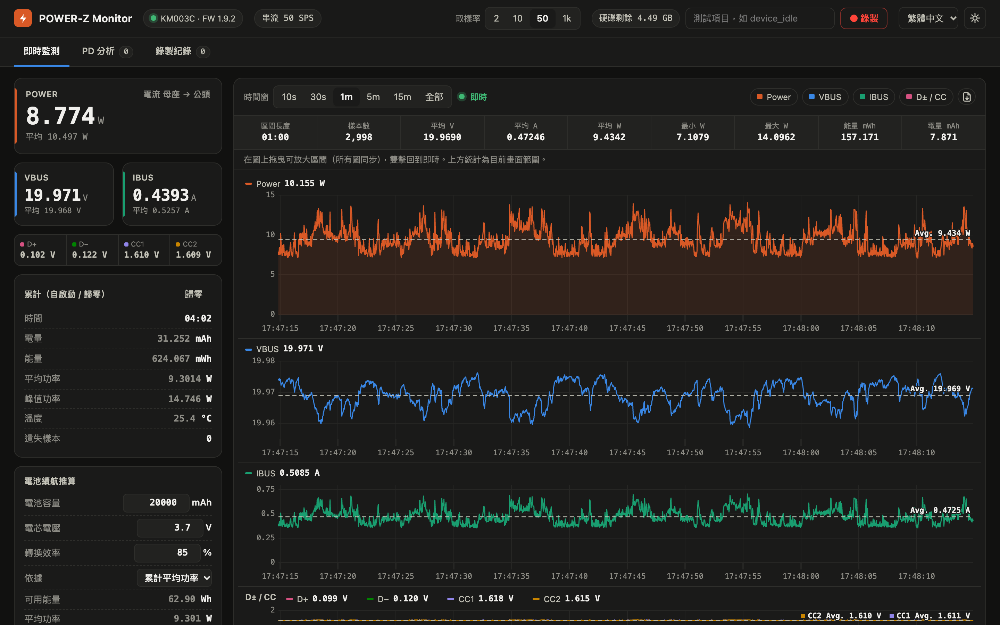
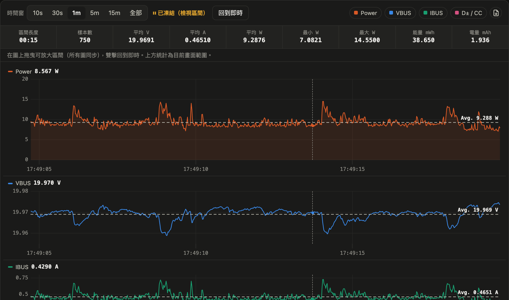
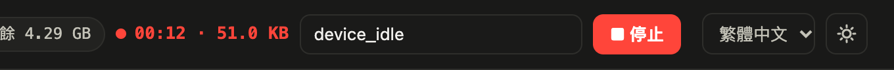
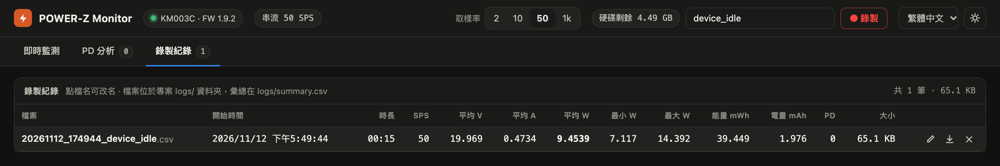
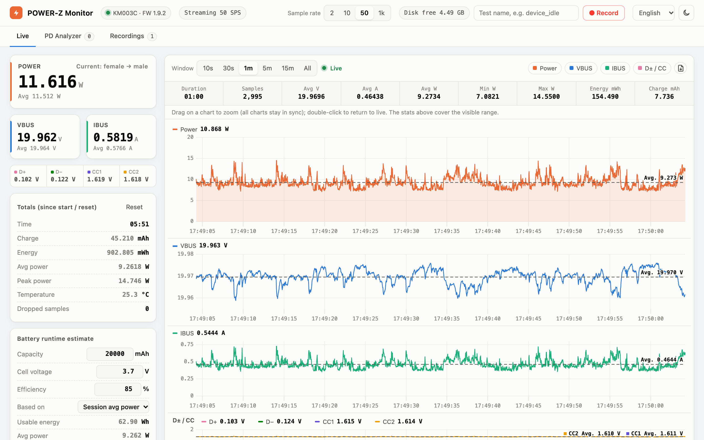

# POWER-Z KM003C Monitor

[繁體中文](README.md) | [简体中文](README.zh-Hans.md) | [English](README.en.md) | [日本語](README.ja.md) | **한국어**

macOS에서 [ChargerLAB POWER-Z KM003C](https://www.chargerlab.com/) USB-C 전력계의 데이터를 보여 주는 웹 대시보드입니다. USB로 측정기와 직접 통신하므로 공식 Windows 소프트웨어가 필요 없습니다. 전압·전류·전력 실시간 그래프, CSV 기록, USB PD 패킷 캡처와 디코딩을 지원합니다.



> 스크린샷은 대부분 번체 중국어 화면입니다. 오른쪽 위 메뉴에서 한국어로 바꿀 수 있습니다.

## 기능

- **실시간 계기**: VBUS / IBUS / Power, D+ / D− / CC1 / CC2, 온도, 전류 방향. 경과 시간, mAh, mWh, 평균·최대 전력 누적
- **고속 그래프**: 샘플링 속도 2 / 10 / 50 / 1000 SPS(측정기의 AdcQueue 스트리밍 사용)
  - Power, VBUS, IBUS, D± / CC 4개 그래프. 커서가 연동되며 최대 60 fps로 부드럽게 스크롤
  - 시간 범위 10초부터 전체까지. 드래그로 구간 확대(4개 그래프 연동), 더블클릭으로 실시간 복귀
  - 각 그래프에 화면 구간 평균값을 점선으로 표시. 통계 행에 구간 길이, 샘플 수, 평균 V / A / W, 최소 / 최대 W, 에너지, 전하량 표시
  - 현재 화면 범위의 원본 데이터를 CSV로 내보내기
- **PD 분석**: USB PD 메시지를 캡처하고 디코딩
  - Source_Capabilities의 PDO(Fixed / PPS / AVS 등)
  - Request의 RDO(어떤 전압 단계를 요청했는지 자동 대응)
  - VDM 등 기타 메시지
  - GoodCRC 숨기기, CSV 내보내기
- **기록**: 기록할 때마다 CSV를 `logs/`에 저장하고 통계 요약을 `logs/summary.csv`에 추가. 기록 중 PD 메시지가 있으면 `*_pd.csv`로도 저장
  - 기록 목록에서 이름 변경, 다른 이름으로 저장, 삭제 가능
- **디스크 보호**: 오른쪽 위에 남은 공간 표시. 기준값(기본 1 GB) 미만이면 기록을 시작할 수 없고, 기록 중이면 자동으로 중지하고 저장
- **배터리 사용 시간 추정**: 배터리 용량, 셀 전압, 변환 효율을 입력하면 평균 전력으로 사용 시간을 추정
- **UI**: 다크 / 라이트 모드. 언어는 번체 중국어(기본), 간체 중국어, English, 日本語, 한국어

## 화면 안내

### 실시간 모니터링

맨 위의 스크린샷이 실시간 모니터링 화면입니다.

- **왼쪽 계기**: 위쪽은 POWER와 VBUS / IBUS의 현재값과 측정기 자체 평균값이며, POWER 카드 오른쪽 위에 전류 방향을 표시합니다. 그 아래 한 줄은 D+ / D− / CC1 / CC2 전압입니다.
- **누적**: 시작 또는 「초기화」를 누른 뒤부터의 시간, 전하량(mAh), 에너지(mWh), 평균·최대 전력, 온도, 누락 샘플 수(정상이면 0).
- **배터리 사용 시간 추정**: 배터리 용량, 셀 전압, 변환 효율을 입력하면 평균 전력으로 사용 시간을 추정합니다(계산 방법은 [아래](#배터리-사용-시간-추정) 참고).
- **오른쪽 위**: 샘플링 속도(2 / 10 / 50 / 1k SPS), 기록, 언어, 다크 / 라이트 모드 전환.
- **그래프**: 시간 범위(10초~전체)를 고를 수 있습니다. 오른쪽의 색상 버튼으로 그래프를 개별적으로 숨기거나 표시하고, 맨 오른쪽 아이콘으로 현재 화면 범위의 원본 데이터를 CSV로 내보냅니다. 각 그래프의 점선과 「Avg.」 라벨은 화면 범위의 평균값입니다.

### 구간 확대와 구간 통계



아무 그래프에서나 **드래그**하면 4개 그래프가 같은 시간 구간으로 함께 확대되고 「일시정지」 상태가 됩니다. 통계 행에 그 구간의 길이, 샘플 수, 평균 V / A / W, 최소 / 최대 전력, 에너지, 전하량이 표시되므로, 부팅이나 동영상 재생 같은 특정 동작 중의 소비 전력을 측정할 때 편리합니다. 「실시간으로」를 누르거나 그래프를 **더블클릭**하면 실시간 스크롤로 돌아갑니다.

### 기록



오른쪽 위에 테스트 이름을 입력하고 「● 기록」을 누릅니다. 기록 중에는 경과 시간과 현재 파일 크기가 표시되며, 「■ 중지」를 누르면 종료하고 저장합니다.



「기록 목록」 탭에 기록별 통계 요약이 나열됩니다. **파일 이름을 클릭**하면 바로 이름을 바꿀 수 있습니다. 오른쪽의 아이콘 3개는 이름 변경, 다른 이름으로 저장(Chrome / Edge에서는 저장 위치를 고르는 창이 열립니다), 삭제입니다.

### 다크 / 라이트 모드와 다국어



오른쪽 위에서 언어(번체 중국어, 간체 중국어, English, 日本語, 한국어)와 다크 / 라이트 모드를 바꿀 수 있습니다. 선택한 설정은 브라우저에 저장되어 다음에도 유지됩니다.

### PD 분석

「PD 분석」 탭에 캡처한 USB PD 메시지가 나열됩니다. 메시지를 하나 선택하면 오른쪽에 디코딩 내용이 표시됩니다: Source_Capabilities의 각 전압·전류 단계, Request가 요청한 단계, 플래그, 원본 데이터. 측정 대상 기기를 다시 연결하면 전체 협상 과정을 볼 수 있습니다.

## 요구 사항

- macOS(Apple Silicon, macOS 27에서 테스트)
- Python 3.10 이상
- [Homebrew](https://brew.sh/)로 설치한 `libusb`
- POWER-Z KM003C(데이터 포트를 USB 케이블로 컴퓨터에 연결. 펌웨어 1.9.2에서 테스트)

## 설치

```bash
git clone https://github.com/alanyeh1128/powerz-km003c-monitor.git
cd powerz-km003c-monitor
brew install libusb
python3 -m venv .venv
.venv/bin/pip install -r requirements.txt
```

## 사용법

Finder에서 `PowerZ Monitor.command`를 더블클릭하거나 터미널에서 다음을 실행합니다.

```bash
.venv/bin/python powerz_monitor.py
```

브라우저에서 <http://127.0.0.1:8780/>이 자동으로 열립니다. 종료하려면 `Ctrl+C`를 누릅니다.

| 옵션 | 기본값 | 설명 |
|---|---|---|
| `--rate 0..3` | `2` | 시작 시 샘플링 속도: 0 = 2 SPS, 1 = 10 SPS, 2 = 50 SPS, 3 = 1000 SPS(나중에 화면에서 변경 가능) |
| `--port` | `8780` | 웹 서버 포트(127.0.0.1에서만 수신) |
| `--min-free-gb` | `1` | 디스크 남은 공간이 이 값보다 작아지면 기록 중지 |
| `--no-browser` | | 시작할 때 브라우저를 열지 않음 |

### 측정 팁

- 장시간 소비 전력 측정에는 **50 SPS**면 충분합니다. 순간적인 전류 피크를 볼 때만 1000 SPS로 바꾸세요
- PD 협상 과정을 캡처하려면 먼저 「PD 분석」 탭을 연 다음 측정 대상 기기를 다시 연결하세요

## 기록 파일 형식

**`logs/<시간>_<이름>.csv`**: 샘플당 한 행

| 열 | 설명 |
|---|---|
| `timestamp` | 로컬 시간(밀리초 단위) |
| `elapsed_s` | 기록 시작 후 경과한 초 |
| `vbus_V`, `ibus_A`, `power_W` | 전압, 전류(측정기 원래 부호 유지), 전력(절댓값) |
| `dp_V`, `dm_V`, `cc1_V`, `cc2_V` | D+ / D− / CC1 / CC2 전압 |

**`logs/summary.csv`**: 기록당 한 행. 길이, 샘플링 속도, 평균 V / A / W, 최소 / 최대 W, 에너지 mWh, 전하량 mAh, PD 메시지 수를 포함합니다.

**`logs/<시간>_<이름>_pd.csv`**: 기록 중 캡처한 PD 메시지. 시간, SOP, 역할, 메시지 종류, 디코딩 내용, 원본 데이터를 포함합니다.

CSV는 한 행에 약 90바이트입니다. 50 SPS에서 시간당 약 16 MB, 1000 SPS에서 시간당 약 320 MB입니다.

### 전류 방향(`ibus_A`의 부호)

KM003C(펌웨어 1.9.2)에서 실측한 결과, 전원을 **암**(리셉터클) 쪽에, 측정 대상 기기를 **수**(플러그) 쪽에 연결하는 일반적인 방식에서 IBUS는 **음수**이고, 반대로 연결하면 양수입니다. 이는 아래 참고한 프로토콜 문서의 설명과 반대입니다. 화면에는 「전류 암 → 수」 또는 「전류 수 → 암」처럼 방향이 글자로 표시되므로 부호를 직접 판단할 필요가 없습니다.

## 배터리 사용 시간 추정

```
사용 시간 = 용량 (mAh) × 셀 전압 (V) × 변환 효율 ÷ 평균 전력 (W)
```

보조배터리에 표기된 mAh는 셀 전압(보통 3.6–3.85 V) 기준이지만, 측정 대상 기기는 20 V로 전원을 공급받을 수 있습니다. mAh를 VBUS 쪽 전류로 나누면 몇 배나 과대 추정되므로, 여기서는 에너지로 환산해서 계산합니다. 변환 효율에는 승압 손실이 포함되며, 일반적인 PD 보조배터리는 약 80–90%입니다.

## 주의 사항

- POWER-Z에는 한 번에 하나의 프로그램만 연결할 수 있습니다. 먼저 다른 읽기 도구를 종료하세요.
- 스트리밍 중에는(샘플링 속도와 관계없이) 측정기가 온도를 갱신하지 않습니다. 화면에는 스트리밍 시작 전 마지막 값이 표시됩니다.
- macOS에서만 테스트했습니다. Linux에서도 이론상 동작하지만 udev 권한 설정이나 커널 내장 `powerz` hwmon 드라이버의 바인딩 해제가 필요할 수 있습니다.

## 프로젝트 구조

```
powerz_monitor.py        웹 서버, 샘플링 루프, 통계, 기록, 디스크 보호
km003c.py                KM003C USB 드라이버(연결, 인증, ADC, AdcQueue 스트리밍, PD 패킷)
pd_decode.py             USB PD 메시지 디코더(PDO / RDO / VDM)
static/index.html        웹 UI
static/i18n.js           UI 다국어 문자열
static/uPlot.*           그래프 라이브러리(uPlot 1.6.30, MIT)
PowerZ Monitor.command   macOS 더블클릭 실행 스크립트
```

## 감사의 말

- KM003C USB 프로토콜 세부 사항(패킷 형식, 인증, AdcQueue, PD 패킷)은 [okhsunrog/km003c-protocol-research](https://github.com/okhsunrog/km003c-protocol-research)를 참고했습니다
- 그래프는 [uPlot](https://github.com/leeoniya/uPlot)을 사용합니다(MIT License, 라이선스 조항은 `static/uPlot.LICENSE` 참고)

## 면책 조항

이 프로젝트는 비공식 프로젝트이며 ChargerLAB과 관련이 없습니다. POWER-Z는 ChargerLAB의 상표입니다. 프로토콜은 제3자의 리버스 엔지니어링 자료를 바탕으로 구현했으며, 모든 펌웨어 버전에서 동작을 보장하지 않습니다.

## 라이선스

[MIT License](LICENSE)
