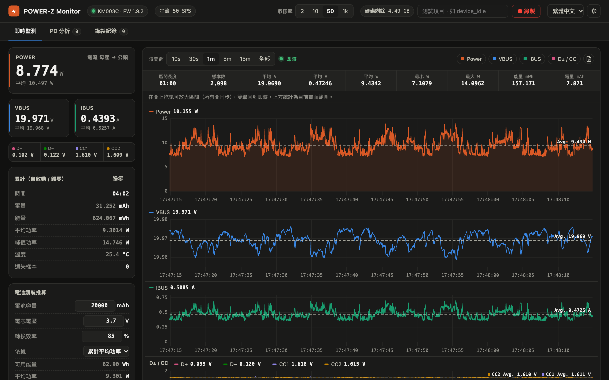
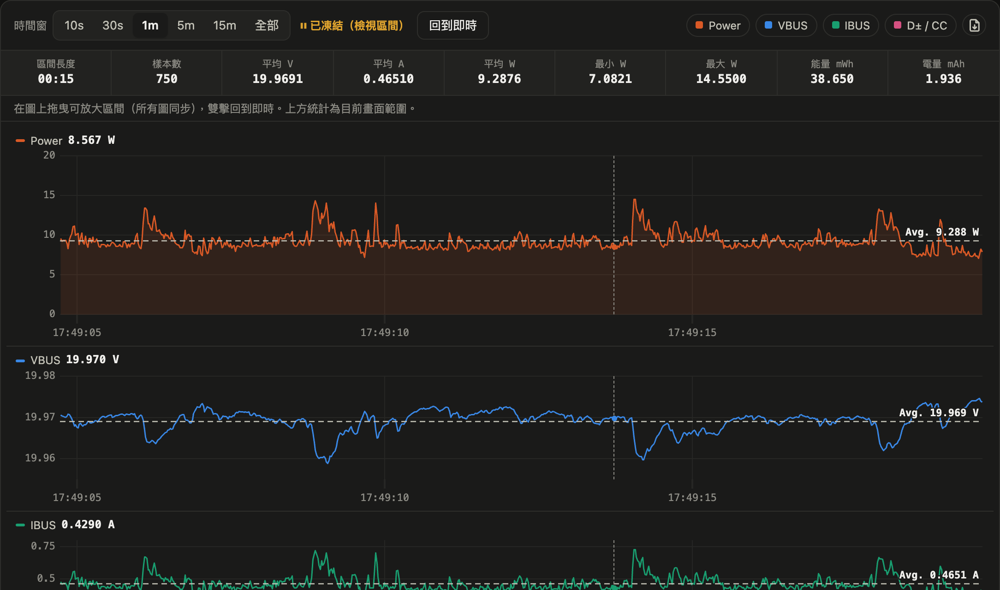
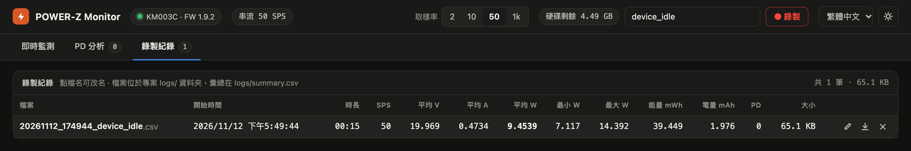
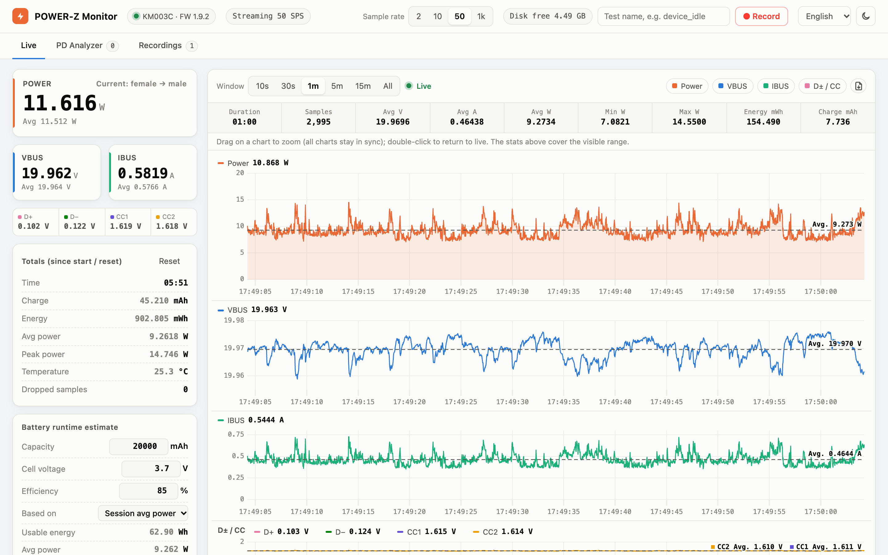

# POWER-Z KM003C Monitor

在 macOS 上讀取 [ChargerLAB POWER-Z KM003C](https://www.chargerlab.com/) USB-C 功率計的網頁儀表板。直接透過 USB 跟裝置溝通，不需要官方的 Windows 軟體。可以即時看電壓、電流、功率曲線，錄製 CSV，以及擷取並解碼 USB PD 封包。



## 功能

- **即時儀表**：VBUS / IBUS / Power、D+ / D− / CC1 / CC2、溫度、電流方向；累計時間、mAh、mWh、平均與峰值功率
- **高速曲線**：取樣率 2 / 10 / 50 / 1000 SPS（使用裝置的 AdcQueue 串流）
  - Power、VBUS、IBUS、D± / CC 四張圖，游標同步，最高 60 fps 流暢捲動
  - 時間窗 10 秒到全部；拖曳可放大區間（四張圖同步），雙擊回到即時
  - 每張圖有畫面區間的平均值虛線；上方統計列顯示區間長度、樣本數、平均 V / A / W、最小 / 最大 W、能量、電量
  - 可把目前畫面範圍的原始資料匯出成 CSV
- **PD 分析**：擷取 USB PD 訊息並解碼
  - Source_Capabilities 的 PDO（Fixed / PPS / AVS 等）
  - Request 的 RDO（自動對應到要求的是哪一檔電壓）
  - VDM 等其他訊息
  - 可隱藏 GoodCRC，並匯出 CSV
- **錄製**：每次錄製存一個 CSV 到 `logs/`，同時把統計摘要寫進 `logs/summary.csv`；錄製期間有 PD 訊息的話另存 `*_pd.csv`
  - 錄製紀錄頁可以改名、另存新檔、刪除
- **硬碟保護**：右上角顯示剩餘空間。低於門檻（預設 1 GB）時拒絕開始錄製；如果正在錄製，會自動停止並保存檔案
- **電池續航推算**：輸入電池容量、電芯電壓、轉換效率，用平均功率推算可以撐多久
- **介面**：深色 / 淺色模式；語系可選繁體中文（預設）、简体中文、English、日本語、한국어

## 畫面導覽

### 即時監測

最上方的截圖就是即時監測頁：

- **左側儀表**：上方是 POWER 和 VBUS / IBUS 的即時值與裝置端平均值，右上角標示電流方向；下面一列是 D+ / D− / CC1 / CC2 電壓。
- **累計**：從啟動或按「歸零」開始累積的時間、電量 (mAh)、能量 (mWh)、平均與峰值功率、溫度，以及遺失樣本數（正常應該是 0）。
- **電池續航推算**：填入電池容量、電芯電壓和轉換效率，依平均功率推算可用多久（算法見[下方](#電池續航推算)）。
- **右上角**：切換取樣率（2 / 10 / 50 / 1k SPS）、錄製、語言、深色 / 淺色模式。
- **圖表**：可選時間窗（10 秒到全部）；右側的彩色按鈕可以隱藏或顯示個別圖表，最右邊的圖示會把目前畫面範圍的原始資料匯出成 CSV。每張圖的虛線和「Avg.」標籤是畫面範圍內的平均值。

### 放大區間與區間統計



在任一張圖上**拖曳**，四張圖會一起放大到同一段時間，進入「已凍結」狀態。上方統計列會顯示這段區間的長度、樣本數、平均 V / A / W、最小 / 最大功率、能量和電量，方便量測某個動作（例如開機、播放影片）期間的耗電。按「回到即時」或在圖上**雙擊**即可恢復即時捲動。

### 錄製


在右上角輸入測試項目名稱後按「● 錄製」。錄製中會顯示經過時間和目前檔案大小，再按一次「■ 停止」就會結束並保存。



「錄製紀錄」頁列出每次錄製的統計摘要。**點檔名**可以直接改名，右側三個圖示分別是改名、另存新檔（Chrome / Edge 會跳出存檔視窗讓你選位置）和刪除。

### 深色 / 淺色模式與多語系



右上角可以切換語言（繁體中文、简体中文、English、日本語、한국어）和深色 / 淺色模式。選擇會記在瀏覽器裡，下次開啟會沿用。

### PD 分析

「PD 分析」頁會列出擷取到的 USB PD 訊息。點任一筆可以在右側看到解碼內容：Source_Capabilities 的每一檔電壓電流、Request 要求的是哪一檔、旗標和原始資料。重新插拔受測裝置就能看到完整的協商流程。

## 系統需求

- macOS（在 Apple Silicon、macOS 27 上測試）
- Python 3.10 以上
- [Homebrew](https://brew.sh/) 安裝的 `libusb`
- POWER-Z KM003C，用 USB 線把它的資料埠接到電腦（在韌體 1.9.2 上測試）

## 安裝

```bash
git clone https://github.com/alanyeh1128/powerz-km003c-monitor.git
cd powerz-km003c-monitor
brew install libusb
python3 -m venv .venv
.venv/bin/pip install -r requirements.txt
```

## 使用

在 Finder 雙擊 `PowerZ Monitor.command`，或在終端機執行：

```bash
.venv/bin/python powerz_monitor.py
```

程式會自動在瀏覽器開啟 <http://127.0.0.1:8780/>。按 `Ctrl+C` 結束。

| 選項 | 預設 | 說明 |
|---|---|---|
| `--rate 0..3` | `2` | 啟動時的取樣率：0 = 2 SPS、1 = 10 SPS、2 = 50 SPS、3 = 1000 SPS（之後可在畫面上切換） |
| `--port` | `8780` | 網頁伺服器的埠號（只聽 127.0.0.1） |
| `--min-free-gb` | `1` | 硬碟剩餘空間低於這個值時停止錄製 |
| `--no-browser` | | 啟動時不自動開瀏覽器 |

### 量測建議

- 長時間量測耗電用 **50 SPS** 就夠了；要看瞬間電流尖峰時才切到 1000 SPS
- 要擷取 PD 協商流程時，先打開「PD 分析」頁，再重新插拔受測裝置

## 錄製檔案格式

**`logs/<時間>_<名稱>.csv`**：每個樣本一列

| 欄位 | 說明 |
|---|---|
| `timestamp` | 本地時間，到毫秒 |
| `elapsed_s` | 從錄製開始經過的秒數 |
| `vbus_V`, `ibus_A`, `power_W` | 電壓、電流（保留裝置原始正負號）、功率（取絕對值） |
| `dp_V`, `dm_V`, `cc1_V`, `cc2_V` | D+ / D− / CC1 / CC2 電壓 |

**`logs/summary.csv`**：每次錄製一列，包含時長、取樣率、平均 V / A / W、最小 / 最大 W、能量 mWh、電量 mAh、PD 訊息數。

**`logs/<時間>_<名稱>_pd.csv`**：錄製期間擷取到的 PD 訊息，包含時間、SOP、角色、訊息類型、解碼內容、原始資料。

CSV 大小大約每筆 90 bytes：50 SPS 約 16 MB/小時，1000 SPS 約 320 MB/小時。

### 電流方向（`ibus_A` 的正負號）

在 KM003C（韌體 1.9.2）上實測：電源接**母座**、受測裝置接**公頭**（正常接法）時，IBUS 是**負值**；反過來接則是正值。這跟下方參考的協定文件描述相反。畫面上會直接顯示「電流 母座 → 公頭」或「電流 公頭 → 母座」，不用自己判斷正負號。

## 電池續航推算

```
續航時間 = 容量 (mAh) × 電芯電壓 (V) × 轉換效率 ÷ 平均功率 (W)
```

行動電源標示的 mAh 是以電芯電壓計算的（通常是 3.6–3.85 V），而受測裝置可能是用 20 V 供電。直接拿 mAh 除以 VBUS 端的電流會高估好幾倍，所以這裡用能量來換算。轉換效率包含升壓的損耗，一般 PD 行動電源大約 80–90%。

## 注意事項

- 同一時間只能有一個程式連著 POWER-Z，使用前請關閉其他讀取工具。
- 用 1000 SPS 串流時，裝置不會更新溫度，畫面上顯示的是開始串流前的最後一筆。
- 只在 macOS 上測試過。Linux 理論上可以執行，但可能需要設定 udev 權限，或先解除綁定核心內建的 `powerz` hwmon 驅動。

## 專案結構

```
powerz_monitor.py        網頁伺服器、取樣迴圈、統計、錄製、硬碟保護
km003c.py                KM003C USB 驅動（連線、認證、ADC、AdcQueue 串流、PD 封包）
pd_decode.py             USB PD 訊息解碼（PDO / RDO / VDM）
static/index.html        網頁介面
static/i18n.js           介面語系字串
static/uPlot.*           圖表函式庫（uPlot 1.6.30，MIT）
PowerZ Monitor.command   macOS 雙擊啟動腳本
```

## 致謝

- KM003C 的 USB 協定細節（封包格式、認證、AdcQueue、PD 封包）參考自 [okhsunrog/km003c-protocol-research](https://github.com/okhsunrog/km003c-protocol-research)
- 圖表使用 [uPlot](https://github.com/leeoniya/uPlot)（MIT License，授權條款見 `static/uPlot.LICENSE`）

## 免責聲明

這是非官方專案，與 ChargerLAB 無關。POWER-Z 是 ChargerLAB 的商標。協定是根據第三方逆向工程的資料實作的，不保證適用於所有韌體版本。
