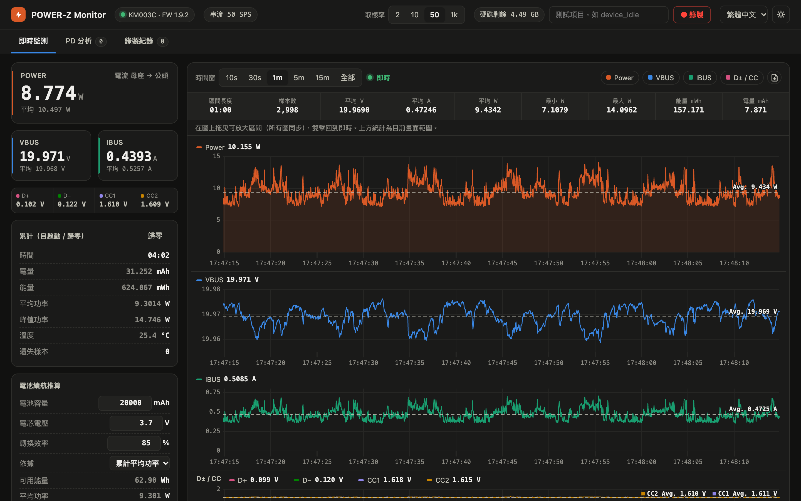
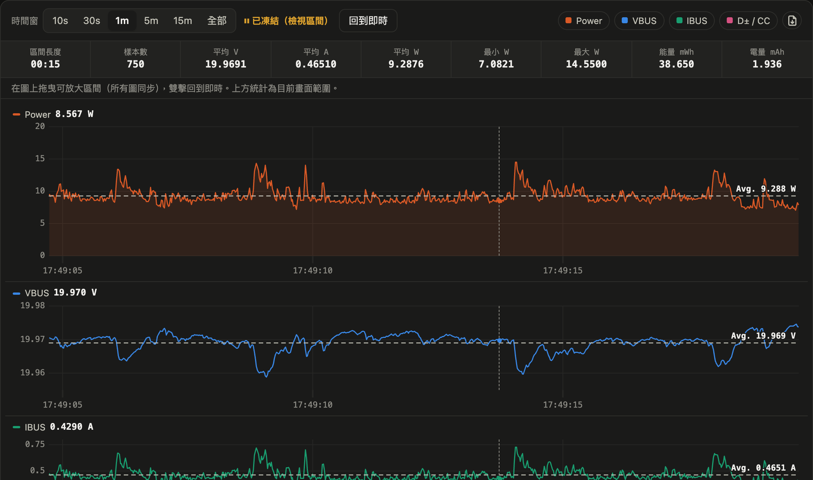
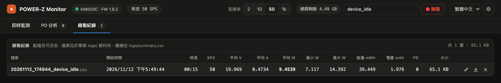
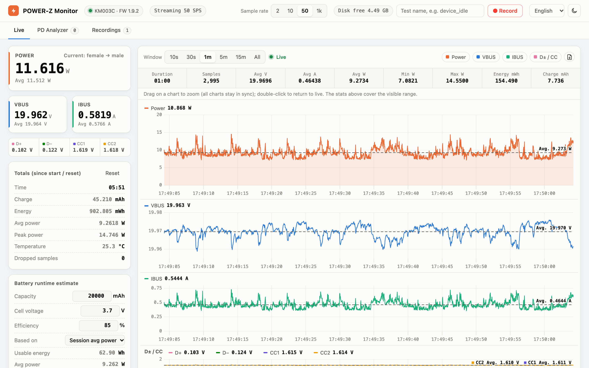

# POWER-Z KM003C Monitor

[繁體中文](README.md) | **简体中文** | [English](README.en.md) | [日本語](README.ja.md) | [한국어](README.ko.md)

在 macOS 上读取 [ChargerLAB POWER-Z KM003C](https://www.chargerlab.com/) USB-C 功率计的网页仪表板。直接通过 USB 与设备通信，不需要官方的 Windows 软件。可以实时查看电压、电流、功率曲线，录制 CSV，以及捕获并解码 USB PD 数据包。



> 截图多为繁体中文界面，可在右上角的菜单切换为简体中文。

## 功能

- **实时仪表**：VBUS / IBUS / Power、D+ / D− / CC1 / CC2、温度、电流方向；累计时间、mAh、mWh、平均与峰值功率
- **高速曲线**：采样率 2 / 10 / 50 / 1000 SPS（使用设备的 AdcQueue 流式传输）
  - Power、VBUS、IBUS、D± / CC 四张图，光标同步，最高 60 fps 流畅滚动
  - 时间窗 10 秒到全部；拖动可放大区间（四张图同步），双击回到实时
  - 每张图有画面区间的平均值虚线；上方统计栏显示区间长度、样本数、平均 V / A / W、最小 / 最大 W、能量、电量
  - 可把当前画面范围的原始数据导出为 CSV
- **PD 分析**：捕获 USB PD 消息并解码
  - Source_Capabilities 的 PDO（Fixed / PPS / AVS 等）
  - Request 的 RDO（自动对应到请求的是哪一档电压）
  - VDM 等其他消息
  - 可隐藏 GoodCRC，并导出 CSV
- **录制**：每次录制保存一个 CSV 到 `logs/`，同时把统计摘要写入 `logs/summary.csv`；录制期间有 PD 消息的话另存 `*_pd.csv`
  - 录制记录页可以重命名、另存为、删除
- **磁盘保护**：右上角显示剩余空间。低于阈值（默认 1 GB）时拒绝开始录制；如果正在录制，会自动停止并保存文件
- **电池续航估算**：输入电池容量、电芯电压、转换效率，按平均功率估算能用多久
- **界面**：深色 / 浅色模式；语言可选繁体中文（默认）、简体中文、English、日本語、한국어

## 界面导览

### 实时监测

最上方的截图就是实时监测页：

- **左侧仪表**：上方是 POWER 和 VBUS / IBUS 的实时值与设备端平均值，右上角标示电流方向；下面一行是 D+ / D− / CC1 / CC2 电压。
- **累计**：从启动或按「归零」开始累计的时间、电量 (mAh)、能量 (mWh)、平均与峰值功率、温度，以及丢失样本数（正常应为 0）。
- **电池续航估算**：填入电池容量、电芯电压和转换效率，按平均功率估算可用时长（算法见[下方](#电池续航估算)）。
- **右上角**：切换采样率（2 / 10 / 50 / 1k SPS）、录制、语言、深色 / 浅色模式。
- **图表**：可选时间窗（10 秒到全部）；右侧的彩色按钮可以隐藏或显示单张图表，最右边的图标会把当前画面范围的原始数据导出为 CSV。每张图的虚线和「Avg.」标签是画面范围内的平均值。

### 放大区间与区间统计



在任一张图上**拖动**，四张图会一起放大到同一段时间，进入「已冻结」状态。上方统计栏会显示这段区间的长度、样本数、平均 V / A / W、最小 / 最大功率、能量和电量，方便测量某个动作（例如开机、播放视频）期间的功耗。点击「回到实时」或在图上**双击**即可恢复实时滚动。

### 录制


在右上角输入测试项目名称后点击「● 录制」。录制中会显示已录时间和当前文件大小，再点一次「■ 停止」就会结束并保存。



「录制记录」页列出每次录制的统计摘要。**点击文件名**可以直接重命名，右侧三个图标分别是重命名、另存为（Chrome / Edge 会弹出保存窗口让你选择位置）和删除。

### 深色 / 浅色模式与多语言



右上角可以切换语言（繁体中文、简体中文、English、日本語、한국어）和深色 / 浅色模式。选择会保存在浏览器中，下次打开时沿用。

### PD 分析

「PD 分析」页会列出捕获到的 USB PD 消息。点击任一条可以在右侧看到解码内容：Source_Capabilities 的每一档电压电流、Request 请求的是哪一档、标志位和原始数据。重新插拔被测设备即可看到完整的协商流程。

## 系统要求

- macOS（在 Apple Silicon、macOS 27 上测试）
- Python 3.10 及以上
- 通过 [Homebrew](https://brew.sh/) 安装的 `libusb`
- POWER-Z KM003C，用 USB 线把它的数据口连接到电脑（在固件 1.9.2 上测试）

## 安装

```bash
git clone https://github.com/alanyeh1128/powerz-km003c-monitor.git
cd powerz-km003c-monitor
brew install libusb
python3 -m venv .venv
.venv/bin/pip install -r requirements.txt
```

## 使用

在 Finder 中双击 `PowerZ Monitor.command`，或在终端执行：

```bash
.venv/bin/python powerz_monitor.py
```

程序会自动在浏览器中打开 <http://127.0.0.1:8780/>。按 `Ctrl+C` 退出。

| 选项 | 默认 | 说明 |
|---|---|---|
| `--rate 0..3` | `2` | 启动时的采样率：0 = 2 SPS、1 = 10 SPS、2 = 50 SPS、3 = 1000 SPS（之后可在界面上切换） |
| `--port` | `8780` | 网页服务器端口（只监听 127.0.0.1） |
| `--min-free-gb` | `1` | 磁盘剩余空间低于该值时停止录制 |
| `--no-browser` | | 启动时不自动打开浏览器 |

### 测量建议

- 长时间测量功耗用 **50 SPS** 就够了；需要看瞬间电流尖峰时再切到 1000 SPS
- 要捕获 PD 协商流程时，先打开「PD 分析」页，再重新插拔被测设备

## 录制文件格式

**`logs/<时间>_<名称>.csv`**：每个样本一行

| 字段 | 说明 |
|---|---|
| `timestamp` | 本地时间，精确到毫秒 |
| `elapsed_s` | 从录制开始经过的秒数 |
| `vbus_V`, `ibus_A`, `power_W` | 电压、电流（保留设备原始正负号）、功率（取绝对值） |
| `dp_V`, `dm_V`, `cc1_V`, `cc2_V` | D+ / D− / CC1 / CC2 电压 |

**`logs/summary.csv`**：每次录制一行，包含时长、采样率、平均 V / A / W、最小 / 最大 W、能量 mWh、电量 mAh、PD 消息数。

**`logs/<时间>_<名称>_pd.csv`**：录制期间捕获到的 PD 消息，包含时间、SOP、角色、消息类型、解码内容、原始数据。

CSV 每行约 90 字节：50 SPS 约 16 MB/小时，1000 SPS 约 320 MB/小时。

### 电流方向（`ibus_A` 的正负号）

在 KM003C（固件 1.9.2）上实测：电源接**母座**、被测设备接**公头**（正常接法）时，IBUS 为**负值**；反过来接则为正值。这与下方参考的协议文档描述相反。界面上会直接显示「电流 母座 → 公头」或「电流 公头 → 母座」，无需自己判断正负号。

## 电池续航估算

```
续航时间 = 容量 (mAh) × 电芯电压 (V) × 转换效率 ÷ 平均功率 (W)
```

充电宝标称的 mAh 是按电芯电压计算的（通常为 3.6–3.85 V），而被测设备可能用 20 V 供电。直接用 mAh 除以 VBUS 端的电流会高估好几倍，所以这里用能量来换算。转换效率包含升压损耗，一般 PD 充电宝约为 80–90%。

## 注意事项

- 同一时间只能有一个程序连接 POWER-Z，使用前请关闭其他读取工具。
- 流式传输期间（任何采样率）设备不会更新温度，界面上显示的是开始流式传输前的最后一次读数。
- 只在 macOS 上测试过。Linux 理论上可以运行，但可能需要配置 udev 权限，或先解除绑定内核自带的 `powerz` hwmon 驱动。

## 项目结构

```
powerz_monitor.py        网页服务器、采样循环、统计、录制、磁盘保护
km003c.py                KM003C USB 驱动（连接、认证、ADC、AdcQueue 流式传输、PD 数据包）
pd_decode.py             USB PD 消息解码（PDO / RDO / VDM）
static/index.html        网页界面
static/i18n.js           界面多语言字符串
static/uPlot.*           图表库（uPlot 1.6.30，MIT）
PowerZ Monitor.command   macOS 双击启动脚本
```

## 致谢

- KM003C 的 USB 协议细节（数据包格式、认证、AdcQueue、PD 数据包）参考自 [okhsunrog/km003c-protocol-research](https://github.com/okhsunrog/km003c-protocol-research)
- 图表使用 [uPlot](https://github.com/leeoniya/uPlot)（MIT License，许可条款见 `static/uPlot.LICENSE`）

## 免责声明

这是非官方项目，与 ChargerLAB 无关。POWER-Z 是 ChargerLAB 的商标。协议根据第三方逆向工程资料实现，不保证适用于所有固件版本。

## 许可证

[MIT License](LICENSE)
